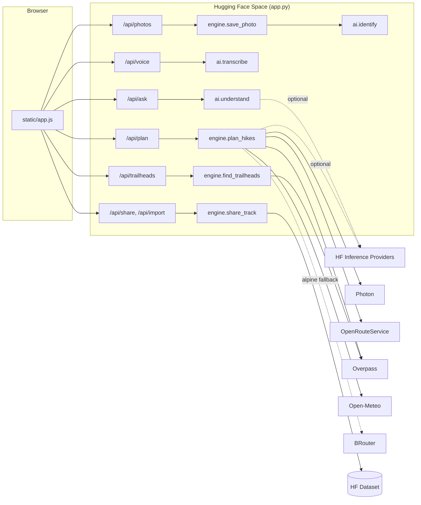

# iHike architecture

iHike suggests real hikes anywhere in Europe from a start point, a destination, or a sentence (typed or spoken). It runs as one Python web server on a Hugging Face Space (CPU only) and leans on free public map, routing and weather services.

This document describes the code as of the import into Git (October 2026). Known problems are listed separately in [AUDIT.md](AUDIT.md).

## Modules

| File | Lines | Role |
|---|---|---|
| `app.py` | ~210 | FastAPI server. Serves the interface, the JSON API and community photos. Maps engine errors to HTTP status codes. Starts Uvicorn on port 7860. |
| `engine.py` | ~1,450 | Everything that is not interface: place search, routing, hike ideas, weather, alerts, recommendation, LLM briefing, GPX, community storage and photo storage. Also builds the JSON sent to the browser. |
| `ai.py` | ~400 | Models that run inside the Space: speech to text (faster-whisper), plants and animals in photos (BioCLIP via open_clip), and the request reader (`parse_request` rules, `_llm_parse`, `_clean`, `understand`). |
| `static/index.html`, `static/app.js`, `static/styles.css` | ~1,700 | The main interface: vanilla JavaScript, no build step. 3D relief map with MapLibre GL and contour lines with maplibre-contour (both vendored in `static/vendor/`). |

### Inside `engine.py`

The file is organised in numbered steps that follow a request:

1. **Places** (`parse_coordinates`, `search_places`, `match_score`, `geocode`): coordinates in many formats, or a name searched with Photon then the OpenRouteService geocoder. A result that matches less than 60 % of the query's words is refused rather than used.
2. **Routes** (`ors_route`, `brouter_route`, `plan_variants`): OpenRouteService `foot-hiking` with elevation and trail difficulty. When it stops more than 300 m short of a destination (it refuses paths graded T5/T6), BRouter's alpine profile is tried.
3. **Hike ideas** (`find_goals_and_trails`, `pick_goals`, `stitch_ways`, `marked_loops`, `suggest_hikes`): one Overpass query lists named summits, passes, lakes, huts, viewpoints, waterfalls and waymarked trails around the start; the ones whose round trip fits the requested time and level are routed.
4. **Car parks** (`find_trailheads`, `plan_from_car_parks`): trailheads and public car parks from Overpass, used to suggest starts and to plan from a destination alone (easiest, medium, hardest).
5. **Weather and alerts** (`get_weather`, `weather_alerts`, `terrain_alerts`): Open-Meteo daily forecast at the highest point of the routes; alert rules on storms, snow, ice, rain, wind, heat, frost, daylight, path grade, altitude and routes that stop short.
6. **Recommendation and briefing** (`suits`, `recommend`, `ai_briefing`, `fallback_briefing`): level limits (beginner up to T2, regular up to T3, seasoned up to T4; T5/T6 never recommended), then an LLM paragraph or a template.
7. **Orchestration and JSON** (`plan_hikes`, `plan_data`, `track_data`, `alert_data`).
8. **Community** (`save_photo`, `publish_photos`, `track_from_geometry`, `share_track`, `public_hike`, `load_hikes`, `save_hike`).

Shared physical model: `estimate_hours()` (a DIN 33466-style rule: the longer of horizontal and vertical time plus half the shorter, with per-level speeds), `climb()` (ascent with a 5 m noise threshold), effort-km (distance + 1 km per 100 m of ascent) and `grade_for()`.

## Request flows

### Typed request

1. The browser posts the sentence to `POST /api/ask`.
2. `ai.understand()` runs `parse_request()` (English and French rules: duration, level, activity, kinds of places, day, start, destination), then `_llm_parse()` if `HF_TOKEN` is set, then `_clean()` on both. LLM fields override rule fields.
3. The browser fills the form with the result and calls `POST /api/plan` itself.

### Spoken request

1. The browser records up to 15 s with `MediaRecorder` and posts the audio to `POST /api/voice`.
2. `ai.transcribe()` loads faster-whisper (`base`, int8, CPU) on first use and transcribes. One lock serialises all transcriptions.
3. The browser puts the text in the search bar and continues as a typed request.

### Planning (`POST /api/plan` → `engine.plan_hikes`)

1. **Start**: `geocode()` the start, unless the mode is a destination trip with no start.
2. **Destination** (trip modes): `geocode()` it.
3. **Routes**, one of three paths:
   - *Ideas from a start*: `suggest_hikes()`: 1 Overpass query, 1 Open-Meteo elevation request, up to 5 ORS routes to goals and up to 2 for waymarked loops. If Overpass fails or nothing fits, `plan_variants()` makes 3 computed loops (ORS round trips).
   - *Start and destination*: `plan_variants()`: ORS with alternative routes; BRouter when ORS stops short (up to 3 attempts, stopped early if BRouter is down).
   - *Destination only*: `plan_from_car_parks()`: 1 Overpass query and up to 6 ORS routes.
4. **Weather**: one Open-Meteo request at the highest point, then the alert rules (plus one elevation request when a route stops short).
5. **Recommendation and briefing**: `recommend()`, then `ai_briefing()` (LLM, 60 s timeout) or `fallback_briefing()`.
6. **Response**: `plan_data()` turns tracks into JSON (geometry decimated to 1,500 points) and parses alert strings into `{severity, title, detail}`.
7. **Follow-up**: the browser then calls `GET /api/trailheads` (1 Overpass query) to show car parks near the start.

### Photos and sharing

1. `POST /api/photos`: Pillow re-encodes the image (EXIF and GPS removed, 1,600 px and 480 px JPEGs) into `pending_photos/`, then `ai.identify()` compares it with 130 European mountain species and 9 "no living subject" prompts using BioCLIP.
2. `POST /api/share` (planned route) or `POST /api/import` (GPX file): the route is validated and its statistics recomputed server side, photos move to `data/photos/`, and a record is appended to `data/hikes.jsonl`.
3. When `HF_TOKEN` and `HIKES_DATASET` are set, a `CommitScheduler` pushes `data/` to a private Hugging Face dataset every 5 minutes, and the Space restores it at start-up with `snapshot_download`.

## External services

| Service | Used for | Key | Timeout in code | Fallback when it fails |
|---|---|---|---|---|
| OpenRouteService directions | All routing, elevation, trail difficulty | `ORS_API_KEY` | 45 s (retried once with a wider snapping radius) | Error shown to the user |
| OpenRouteService geocoder | Place search, second choice | `ORS_API_KEY` | 20 s | Photon results only |
| Photon (Komoot) | Place search, first choice | none | 15 s | ORS geocoder |
| Overpass (4 public mirrors, tried in order) | Goals, waymarked trails, car parks | none | 5 s connect + 30 s read, per mirror | Computed loops, or an error for car parks |
| BRouter (brouter.de) | Alpine routes ORS refuses | none | 5 s connect + 20 s read | ORS route plus a "stops short" alert |
| Open-Meteo forecast | Daily weather at the highest point | none | 20 s | "Forecast unavailable" |
| Open-Meteo elevation | Goal elevations, missing climb | none | 20 s | Elevation treated as unknown |
| HF Inference Providers | Request parsing and briefing (LLM) | `HF_TOKEN` | 30 s (parse), 60 s (briefing) | Rules only, template briefing |
| Hugging Face Hub (dataset) | Community persistence | `HF_TOKEN` | library defaults | Local storage only, lost on restart |
| OpenFreeMap, AWS Terrain Tiles, Google Fonts | Map tiles, relief, fonts (loaded by the browser, not the server) | none | browser | Map without base layer or relief |

No call has retries with backoff today; see the audit.

## In-Space models

| Model | Library | Loaded | Used by |
|---|---|---|---|
| Whisper `base` (override with `WHISPER_MODEL`) | faster-whisper, CTranslate2 int8 | On first voice request | `ai.transcribe` |
| BioCLIP (`hf-hub:imageomics/bioclip`, override with `SPECIES_MODEL`) | open_clip + PyTorch CPU | On first photo | `ai.identify` |

`ai.available()` reports a feature as available when its Python package is installed. It does not check that the model can actually be downloaded or loaded.

## Storage

| Path | Content | Synced to the dataset |
|---|---|---|
| `data/hikes.jsonl` | One JSON record per shared hike (route decimated to 300 points) | Yes |
| `data/photos/` | Photos attached to shared hikes | Yes |
| `pending_photos/` | Photos uploaded but not (yet) shared | No |

## Configuration

All configuration comes from environment variables; see [`.env.example`](../.env.example). The app starts with none of them set and reports in `/api/config` which features are off.

## Deployment

The Space uses the `gradio` SDK (`sdk_version: 5.49.1` in `README.md`) and runs `python app.py`. The code no longer imports Gradio: `app.py` starts its own Uvicorn server on `GRADIO_SERVER_PORT` (7860). The original Gradio interface (`classic.py`) was removed after the import; see the changelog.
